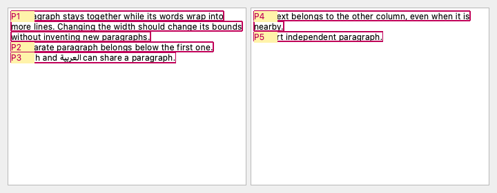

# Give Qt Eyes

A setting says “show six rows,” but the window still shows three. Give Qt Eyes helps your coding agent check what a Qt app actually shows, using screenshots and measurements from the same test.

Use it for clipped text, crowded controls, table rows, or panels that do not open and close as expected. It works with **Qt Widgets and PySide6**. It does not cover QML or prove how an app looks on a real display.

## Add the skill

You need Node.js 22.20 or later for this command:

```sh
npx skills add Belalkf/give-qt-eyes
```

Then ask your agent:

> Use give-qt-eyes to check why the row setting changes from 3 to 6 but only three rows appear. Try the normal controls, compare before and after, and tell me what is still unknown.

The skill uses your project's tests and Qt setup. Adding it does not install Python or Qt, and does not start your app.

## Need saved measurements too?

The optional Python tool saves a screenshot with widget sizes and row counts. It can also mark text paragraphs on a copy of the image.

Install this version from GitHub. You need Python 3.9+ and Git:

```sh
python -m pip install 'git+https://github.com/Belalkf/give-qt-eyes.git@v0.1.0'
```

Inside an existing app test, after the layout is ready:

```python
from give_qt_eyes import capture

before = capture(window, {"table": window.table}, evidence_dir)
# Use the normal control, then wait for the layout to settle.
after = capture(window, {"table": window.table}, evidence_dir)
```

Compare the two saved folders:

```sh
give-qt-eyes compare path/to/before path/to/after
```

You get the measured changes, not an automatic pass or fail. Review the images too. Captures may show private content, so use sample data before sharing them.



## A few useful details

- Python 3.9+ is needed for the tool. Capturing also needs your app's PySide6 6.5–6.x setup.
- Every capture uses a new folder. Earlier images and app settings are kept.
- Tests drawn in memory can check layout, but do not prove display quality, fonts, or accessibility.
- This is an early release. Existing Qt tools already do much of the work; this adds a clear way to collect and compare the evidence.

See [the Python guide](https://github.com/Belalkf/give-qt-eyes/blob/main/docs/python-tool.md), [support and limits](https://github.com/Belalkf/give-qt-eyes/blob/main/docs/support.md), or [how this fits with other tools](https://github.com/Belalkf/give-qt-eyes/blob/main/docs/alternatives.md). Want to help? Read [Contributing](https://github.com/Belalkf/give-qt-eyes/blob/main/CONTRIBUTING.md). Use [private reporting](https://github.com/Belalkf/give-qt-eyes/security/advisories/new) for security problems.

MIT licensed. Qt and other tools keep their own licences.
